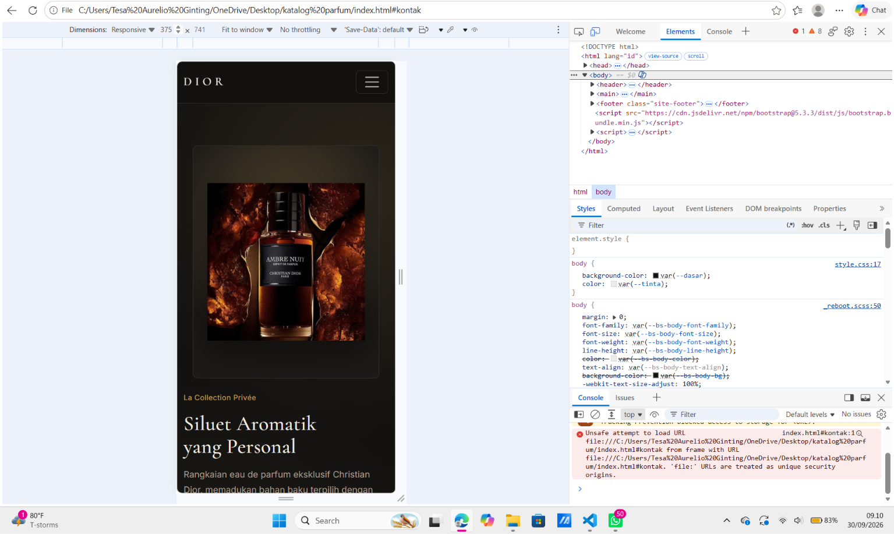
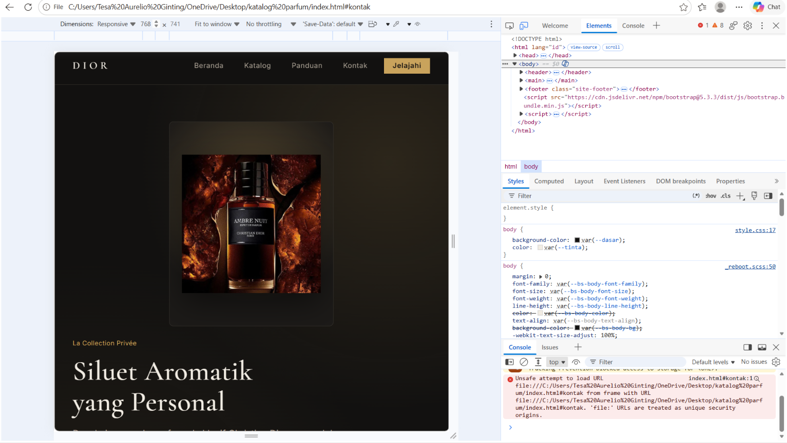
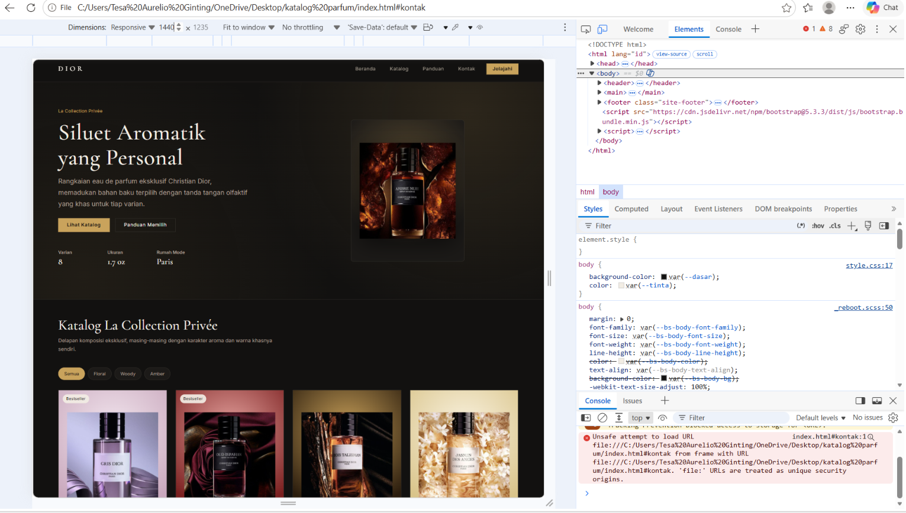

# Dokumentasi Testing Responsif

**Tugas Rutin 3 — Katalog Produk Responsif (La Collection Privée, Dior)**
Mata Kuliah     : Pemrograman Web
Nama            : Tesa Aurelio Ginting
NIM             : 4253250037
Kelas           : PSIK 25B
Program Studi   : Ilmu Komputer, FMIPA

## 1. Ringkasan Proyek

Katalog parfum Dior lini La Collection Privée dibangun dengan **Bootstrap 5**,
pendekatan **mobile-first**. Grid katalog menggunakan sistem `row-cols-*` bawaan
Bootstrap, berpindah dari 1 kolom di mobile hingga 4 kolom di desktop lebar,
sesuai instruksi tugas.

## 2. Daftar Breakpoint yang Digunakan

| Kelas Prefiks | Lebar Minimum | Perangkat Sasaran | Jumlah Kolom Katalog |
| (default) | 0px | Ponsel | 1 kolom |
| `sm` | 576px | Ponsel besar | 2 kolom |
| `md` | 768px | Tablet | 2 kolom + navbar penuh |
| `lg` | 992px | Laptop | 3 kolom |
| `xl` | 1200px | Desktop lebar | 4 kolom |

## 3. Metode Pengujian

1. Buka `index.html` di Google Chrome.
2. Tekan `F12`, aktifkan Toggle device toolbar (`Ctrl+Shift+M`).
3. Uji tiga lebar layar: 375px, 768px, 1440px.
4. Ambil tangkapan layar pada tiap breakpoint.

## 4. Hasil Pengujian

### 4.1 Mobile — 375px

- Grid menampilkan **1 kolom**.
- Navbar menampilkan tombol hamburger.
- Tiap kartu produk tetap menampilkan latar warna berbeda sesuai karakter aromanya.

### 4.2 Tablet — 768px

- Grid menampilkan **2 kolom**.
- Navbar berubah ke mode penuh, tombol hamburger hilang.

### 4.3 Desktop — 1440px

- Grid menampilkan **4 kolom**.
- Hero tampil dua kolom bersebelahan.

## 5. Pemenuhan Requirement

| No | Requirement | Status | Implementasi |
|----|-------------|--------|--------------|
| 1 | Mobile-first approach | Terpenuhi | Kelas dasar Bootstrap untuk mobile, ditambah prefiks `sm-`, `md-`, `lg-`, `xl-` |
| 2 | Minimal 3 breakpoint | Terpenuhi | 4 breakpoint: `sm` 576px, `md` 768px, `lg` 992px, `xl` 1200px |
| 3 | Grid responsif (1→2→3/4 kolom) | Terpenuhi | `row-cols-1 row-cols-sm-2 row-cols-lg-3 row-cols-xl-4` |
| 4 | Card produk (gambar + info + harga + btn) | Terpenuhi | 8 kartu lengkap dengan gambar, jenis aroma, indikator intensitas, harga, tombol |
| 5 | Navbar responsif (hamburger di mobile) | Terpenuhi | Komponen navbar Bootstrap bawaan |
| 6 | Responsive images | Terpenuhi | `srcset` + `sizes` pada tiap ``, `loading="lazy"` |
| 7 | `clamp()` untuk typography | Terpenuhi | Kelas `.judul-hero`, `.judul-seksi`, `.judul-kartu`, `.teks-kartu`, `.harga-kartu` |
| 8 | Footer | Terpenuhi | Footer 3 kolom dengan keterangan hak cipta |
| 9 | Dokumentasi testing | Terpenuhi | Berkas ini beserta tiga tangkapan layar |

